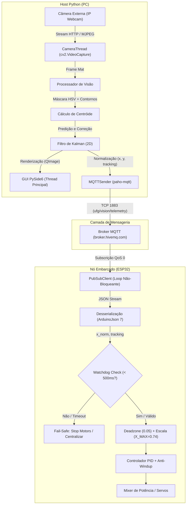
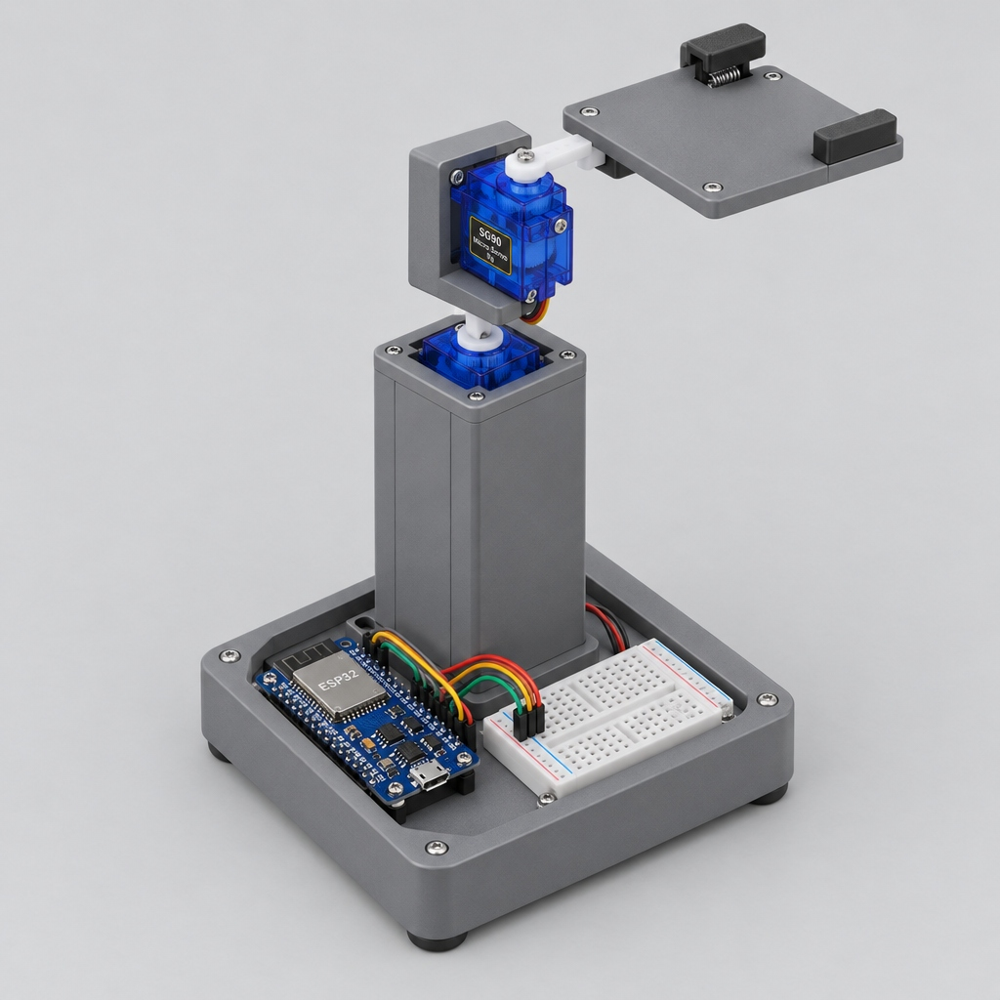

# Vision Tracker V2 🎯

> **Sistema Distribuído de Visão Computacional, Telemetria MQTT e Controle Embarcado em Tempo Real**

[](https://github.com/Matxxxz/Rastreador_Visao_v2)
[-orange?style=for-the-badge&logo=target)](https://github.com/Matxxxz/Rastreador_Visao_v2)
[-blue?style=for-the-badge&logo=espressif)](https://github.com/pioarduino/platform-espressif32)
[](https://www.python.org/)
[](https://opencv.org/)
[-green?style=for-the-badge&logo=qt)](https://www.qt.io/)

---

## 📌 Visão Geral

O **Vision Tracker V2** é uma solução de engenharia AIoT (Artificial Intelligence of Things) para rastreamento visual autônomo com arquitetura cliente-servidor distribuída e orientada a eventos. O sistema desacopla a alta carga computacional de processamento de imagem do nó de controle físico em tempo real:

1. **Host de Visão (Python / OpenCV / PySide6):** Captura o feed de vídeo de um smartphone via IP Webcam, aplica segmentação por cor no espaço HSV, extrai o centróide geométrico com filtragem preditiva de Kalman (tolerância de 15 frames para oclusões parciais) e publica coordenadas espaciais normalizadas via protocolo MQTT assíncrono a 30 Hz.
2. **Nó de Controle Físico (ESP32 / C++):** Microcontrolador responsável por consumir a telemetria, executar a normalização do sensor, aplicar controle cinemático (PID com anti-windup e deadzone) e atuar os elementos mecânicos com proteção autônoma por Watchdog de rede.

O projeto encontra-se na transição entre a **Fase 1 (Validação Completa em Simulação)** e a **Fase 2 (Construção da Torreta Física Pan-Tilt de Mesa)**.

---

## 🤖 Metodologia de Desenvolvimento & Engenharia com IA
Projeto experimental concebido e implementado com o suporte de ferramentas de IA generativa (*Cursor* e *Antigravity*).

- **Responsabilidade Autoral:** Arquitetura distribuída orientada a eventos, integração de protocolos, calibração manual de parâmetros ópticos/espaciais (coeficiente de tolerância 0.74 via IP Webcam), depuração de concorrência, elaboração do plano de testes e versionamento estruturado (28 commits).
- **Fase 1 (Atual):** Validação funcional de ponta a ponta em simulação (Wokwi + HiveMQ Broker).
- **Fase 2 (Roadmap):** Atuação em bancada física com servos Pan-Tilt e hardware dedicado.

---

## 🏗️ Arquitetura do Sistema

O fluxo de dados é 100% assíncrono e não-bloqueante em todas as camadas da aplicação:



### Contrato de Dados (Telemetria MQTT)

A telemetria é serializada em JSON e transmitida no tópico `ufg/vision/telemetry`:

```json
{
  "x": -0.421,
  "y": 0.158,
  "tracking": true
}
```

* `x`: Erro angular horizontal normalizado $[-1.0, +1.0]$ ($0.0$ = centro geométrico da câmera).
* `y`: Erro angular vertical normalizado $[-1.0, +1.0]$.
* `tracking`: Flag booleana indicando se o objeto alvo está ativo e com lock válido.

---

## 🚀 Status de Desenvolvimento e Roadmap

```
[==================== FASE 1: 100% CONCLUÍDA ====================]  ---> [==== FASE 2: PLANEJADA ====]
Pipeline Python + Wokwi + ESP32 Core 3.x + PID Normalizado + Watchdog      Torreta Pan-Tilt Física SG90
```

### ✅ Fase 1: Simulação & Loop E2E (Concluída e Validada)

Nesta etapa, todo o pipeline de software e firmware foi implementado, integrado e validado utilizando simulação de hardware no Wokwi e instrumentação serial:

* **Host Python Modular:**
  * Arquitetura multithreaded desacoplada (`QThread` para captura de vídeo, evitando travamento da interface gráfica).
  * Filtro de Kalman cinemático implementado com vetor de estado $[x, y, v_x, v_y]^T$ e time-to-live (TTL) de 15 frames para lidar com oclusões transitórias.
  * Reset determinístico de estado ao perder o alvo (`has_lock = False` e `kalman.reset()`).
* **Firmware C++ de Alta Confiabilidade:**
  * Compilado via **PlatformIO** utilizando a plataforma `pioarduino` com **Arduino ESP32 Core 3.3.x / ESP-IDF 5.5**, eliminando APIs depreciadas (`ledcSetup`, `ledcAttachPin`) e adotando `ledcAttach` moderno.
  * Parser com **ArduinoJson v7** (`JsonDocument` dinâmico).
  * Simulação validada no Wokwi com telemetria em tempo real.

#### Soluções Técnicas Críticas da Fase 1

| Desafio de Engenharia | Causa Raiz | Solução Adotada | Impacto Prático |
|---|---|---|---|
| **Motor Oposto Não Desligava (PWM Residual)** | A lente da câmera IP e o campo útil de visão entregavam na prática $\|x_{norm}\| \approx 0.74$ na borda, e não $1.0$. Com $K_p = 120$ e $PWM_{base} = 120$, a saída PID atingia no máximo $88.8$, gerando $PWM_{min} = 120 - 88.8 = 31.2$ (o motor oposto nunca cortava potência). | Normalização pelo limite prático: $e_{norm} = \text{constrain}(x / 0.74, -1.0, 1.0)$. | Ao atingir a borda útil ($\ge 0.74$), $e_{norm} = 1.0 \implies PID = 120 \implies PWM = 120 - 120 = 0$. Corte de potência 100% garantido. |
| **Micro-vibração e Aquecimento no Centro** | Ruído residual de centróide próximo a zero induzia alternância rápida de PWM. | Implementação de **Deadzone Central** ($\|x_{norm}\| < 0.05 \implies e = 0$). | Eliminação de zumbido eletromagnético e economia energética quando o alvo está centrado. |
| **Travamento por Perda de Rede (Segurança)** | O método tradicional `reconnect()` com `delay(5000)` bloqueava o microcontrolador caso o broker caísse, mantendo os motores ligados na última velocidade. | Máquina de Estados Finita (FSM) com temporização via `millis()` (`IDLE`, `CONNECTING`, `WAITING`). | Loop principal roda livremente em microsegundos mesmo sem conexão; Watchdog nunca é bloqueado. |
| **Acidente por Perda de Sinal (Fail-Safe)** | Queda do host Python ou timeout de Wi-Fi mantinha atuadores acionados indefinidamente. | **Watchdog de Rede de 500 ms** baseado em timestamp da última mensagem MQTT recebida. | Se nenhum pacote chegar em 500 ms, `stopMotors()` é disparado imediatamente. |
| **Saturação do Integrador (Windup)** | Oclusões de longa duração com erro constante levavam o termo integral ao infinito. | Trava de saturação (**Anti-Windup**) com limitador rígido `MAX_INTEGRAL = 127.0f` e reset automático no destravamento do alvo. | Resposta transiente sem overshoot violento ao reaver o alvo. |

---

### ⏳ Fase 2: Torreta Pan-Tilt de Mesa (Próximo Passo / Em Planejamento)

Com a lógica de controle e a comunicação E2E consolidadas na simulação, o projeto avança para a construção física de uma **Torreta Pan-Tilt de Mesa (2 Graus de Liberdade)**, otimizada para bancada e baixo custo.

<div align="center">
  
  <p><em>Figura 1: Conceito mecânico 3D da Torreta Pan-Tilt com base integrada (ESP32 + Mini-Protoboard) e controle angular por Micro-Servos SG90.</em></p>
</div>

#### Especificações de Engenharia da Fase 2:
* **Estrutura Mecânica:**
  * **Base Compacta com Gabinete Integrado:** Compartimento para o ESP32 DevKit C V4 e mini-protoboard de 170 pontos, garantindo organização dos chicotes e centro de massa rebaixado.
  * **Coluna de Rotação Vertical (Eixo Pan):** Torre rígida com servo SG90 montado verticalmente para controle do azimute horizontal ($0^\circ \dots 180^\circ$).
  * **Braço Articulado de Elevação (Eixo Tilt):** Suporte superior com segundo servo SG90 montado horizontalmente para controle de elevação vertical.
  * **Berço de Câmera/Smartphone:** Suporte com grampos emborrachadas e ajuste por mola, projetado para coincidir o centro de gravidade (CG) do dispositivo móvel com o eixo de rotação do servo de Tilt, minimizando torque estático.
* **Eletrônica e Potência:**
  * Alimentação dedicada via fonte externa regulada de **$5\text{ V} / 2\text{ A}$** (evitando quedas de tensão no rail USB do ESP32 provocadas pelos picos de corrente de stall dos servos de $\approx 400\text{ mA}$).
  * Barramento de terra comum (**GND unificado**) e capacitor eletrolítico de desacoplamento ($100\ \mu\text{F} / 10\text{ V}$) no rail dos servos.
* **Firmware e Controle de Posição:**
  * Transição do controle de tração diferencial para **controle angular absoluto** via biblioteca `ESP32Servo`.
  * Mapeamento linear com **Software Stops** para preservação das engrenagens mecânicas:
    $$\theta_{pan} = \text{constrain}\left(90^\circ + \frac{x_{norm}}{X_{MAX}} \cdot 90^\circ,\ 10^\circ,\ 170^\circ\right)$$
    $$\phi_{tilt} = \text{constrain}\left(90^\circ - \frac{y_{norm}}{Y_{MAX}} \cdot 60^\circ,\ 30^\circ,\ 150^\circ\right)$$
  * Comportamento seguro de Watchdog: em caso de perda de stream, a torreta retorna suavemente para a posição neutra de repouso ($90^\circ / 90^\circ$).

---

## 📂 Estrutura do Repositório

```bash
Rastreador_Visao_v2/
├── docs/                               # Documentação e artefatos de engenharia
│   └── assets/
│       └── pan_tilt_concept.jpg        # Render do conceito 3D da Torreta Pan-Tilt
├── firmware/                           # Subprojeto Embarcado (PlatformIO)
│   ├── diagram.json                    # Circuito de simulação do Wokwi
│   ├── platformio.ini                  # Configuração do pioarduino (Core 3.3.x)
│   └── src/
│       └── main.cpp                    # Firmware C++ (LEDC, PID, Watchdog, MQTT)
├── src/                                # Host de Visão Computacional (Python)
│   ├── gui/
│   │   └── app.py                      # Interface Gráfica reativa (PySide6 / Qt6)
│   ├── io/
│   │   └── mqtt_sender.py              # Cliente MQTT assíncrono (Paho-MQTT)
│   └── vision/
│       ├── camera.py                   # Thread de captura de vídeo resiliente
│       ├── kalman.py                   # Filtro de Kalman cinemático 2D
│       └── processor.py                # Pipeline HSV, contornos e normalização
├── config.py                           # Parâmetros locais do host (ignorado no Git)
├── main.py                             # Ponto de entrada da aplicação Python
├── requirements.txt                    # Dependências Python congeladas
└── settings.example.json               # Modelo de calibração HSV de referência
```

---

## 🛠️ Como Executar

### Pré-requisitos
* Sistema Operacional: Windows 10/11 (PowerShell).
* Python 3.10.x com ambiente virtual configurado.
* PlatformIO Core (instalado globalmente via `pipx` ou extensão no VS Code).

### 1. Inicializando o Host de Visão (Python)

Abra o terminal PowerShell na raiz do projeto:

```powershell
# Ativar o ambiente virtual
.\.venv\Scripts\Activate.ps1

# Instalar as dependências (caso seja a primeira execução)
pip install -r requirements.txt

# Copiar a configuração inicial (se settings.json não existir)
Copy-Item settings.example.json settings.json

# Executar a aplicação principal
python main.py
```

*Na interface gráfica, insira o URL da câmera (ex: `http://192.168.0.X:8080/video`) e clique em **Iniciar Câmera** e **Conectar MQTT**.*

### 2. Compilando e Executando o Firmware (ESP32)

Abra um segundo terminal na pasta `firmware/`:

```powershell
cd firmware

# Compilar o firmware com o pioarduino Core 3.x
pio run --environment esp32dev

# Para upload em hardware real:
pio run --target upload --environment esp32dev
pio device monitor --baud 115200
```

#### Simulação via Wokwi (Sem Hardware)
* Abra o arquivo `firmware/diagram.json` no VS Code com a extensão do Wokwi instalada e pressione `F1` > **Wokwi: Start Simulator**.
* Ou acesse o projeto público web: [Wokwi Vision Tracker V2](https://wokwi.com/projects/473098176905324545).

---

## 👨‍💻 Autor

**Mateus Augusto Guimarães**  
*Graduando em Engenharia de Computação — Universidade Federal de Goiás (UFG)*  
*Foco: Sistemas Embarcados, Visão Computacional e IoT de Baixa Latência.*
